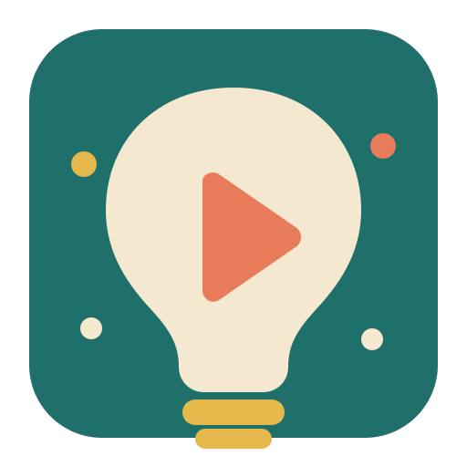

# YouLearn

<p align="center">
  
</p>

A web app for kids to watch the shows their parents picked from YouTube, and
nothing else. No recommendations, no autoplaying next video, no way out to
the rest of YouTube.

It wraps YouTube's own embedded player with its controls hidden, covers it
with kid-sized controls of its own, and stops each episode just before
YouTube's end screen can appear. Episodes are grouped by show and season,
full episodes only.

Install it from https://youlearn.finereli.com: on an iPad, open it in Safari
and choose Share → Add to Home Screen. Guided Access (Settings →
Accessibility) can lock the iPad into it.

The original native macOS app lives in git history (tag `v0.3.1`).

## Develop

```sh
npm install
npm run dev
npm run library     # rebuild the catalog (worker/catalog.json) from content/
```

## License

MIT.
